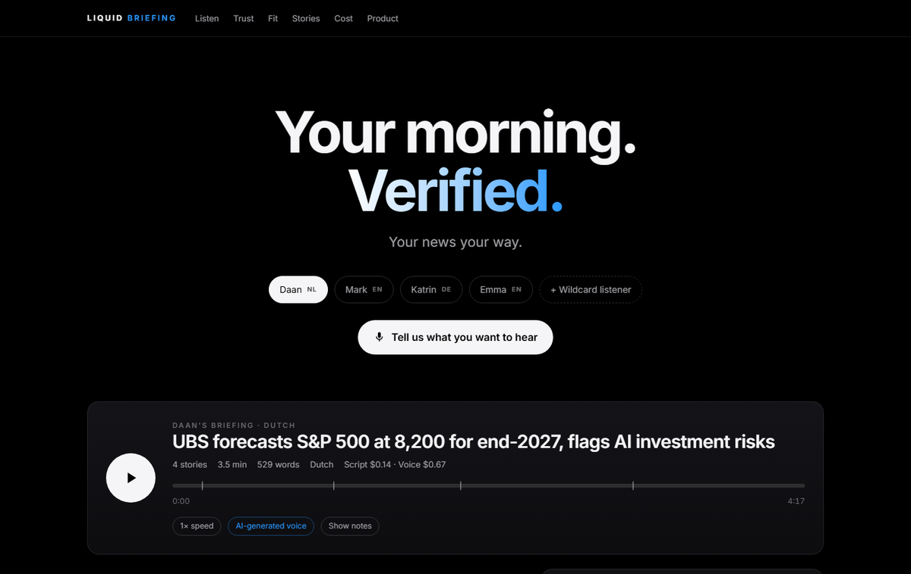
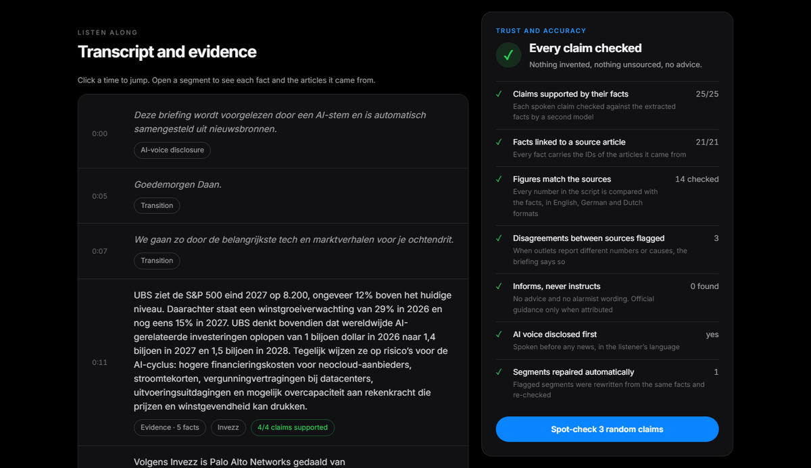
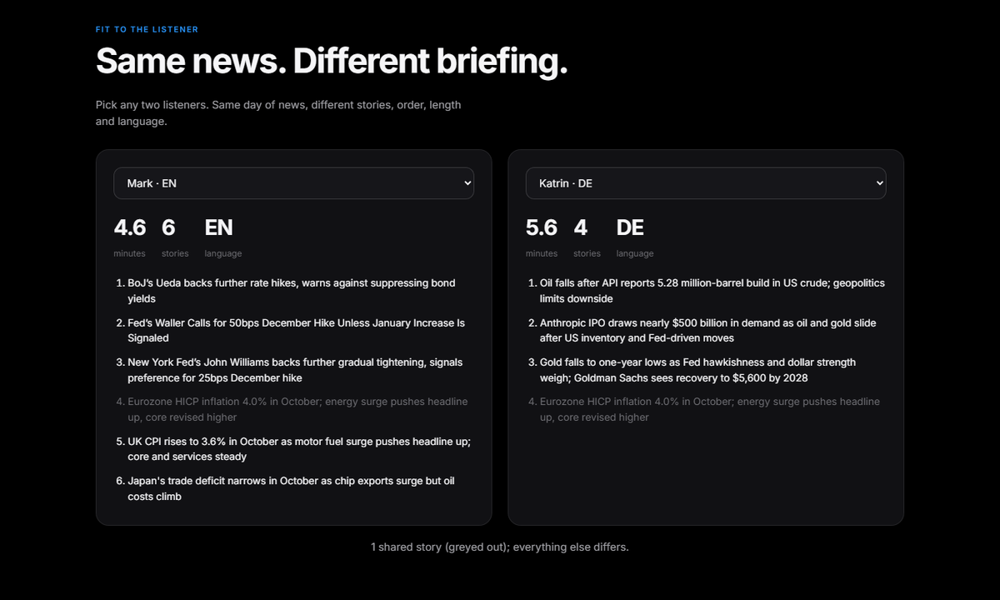
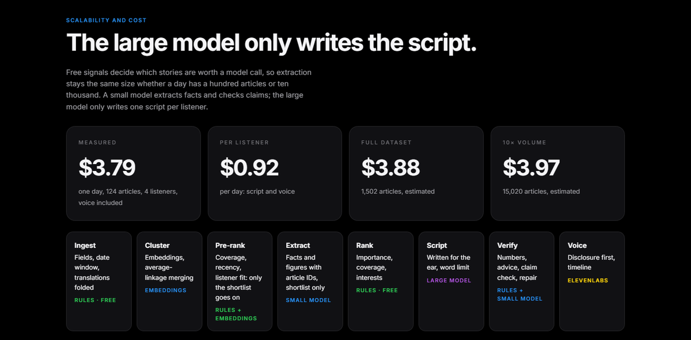

# The Liquid Briefing

**A personal audio news briefing you can trust.** Liquid Briefing turns a day of news into a short spoken
briefing for one listener. It groups the articles into stories, picks what matters to that person, writes a
script for the ear, checks every claim against its source, and reads it aloud. Every number and claim in the
audio links back to the article it came from.

Built at the MAIN AI Hackathon 2026 (Maastricht, Sourcera track) by team **IT WORKS LOCALLY**: Georgios and Simon.



## Screenshots

**Transcript and trust report.** Every segment opens up to its facts and source articles; the trust report shows
what was checked, and "Spot-check 3 random claims" puts claims next to their articles.



**Same news, different briefing.** Two listeners side by side: different stories, order, length and language.



**Cost.** Measured per edition and per listener, with estimates for the full dataset and ten times the volume.



## Features

**Listen**
- A spoken briefing per listener, at the length they choose, written for the ear: greeting, overview, stories, sign-off.
- Every edition opens with a spoken AI-voice disclosure in the listener's language.
- A player with a transcript that follows along; click any time or drag the bar to jump.
- Six voices to choose from (ElevenLabs), each speaking English, Dutch and German.

**Trust every claim**
- Each sentence links to its facts, and each fact links to the source article.
- Before any audio is made, a second model checks every spoken claim against its facts, and every number is
  compared with the sources (English, German and Dutch number formats, "1,4 biljoen" included).
- When outlets disagree, the briefing says so and gives both sides with their sources.
- It informs and never instructs: no advice of any kind and no alarmist wording. Official guidance is reported
  only when it is attributed.
- Flagged segments are rewritten from the same facts and checked again; a briefing that still fails gets no voice.
- A trust report on the page, and a "spot-check 3 random claims" button that shows each claim next to its article.

**Made for each listener**
- Profiles set language, interests, topics to avoid, depth, length, tone and voice.
- Different listeners get different stories, order, length and language from the same news, shown side by side.
- "Why these stories" explains which interests each story matched.
- **Wildcard listener:** create a new profile on the page and get a briefing in a few minutes.
- **Voice request:** say what you want ("I'm Sophie. Three minutes on gold and the ECB, and I definitely want to
  hear about the Anthropic IPO."). It shows what it understood before producing anything.
- **Must hear:** name a story and it goes first, or you are told it is not in today's news.

**Makes sense of the news**
- Articles about the same event are grouped into one story; near-identical copies are merged.
- German and Dutch translations are folded into their English original, with links in the listener's language.
- Facts, figures and disagreements are extracted per story, and stories are ranked by importance and coverage.

**Cheap at scale**
- Free signals (coverage, recency, listener fit) decide which stories are worth a model call, so extraction does
  not grow with article volume. A new listener's missing stories are extracted on demand.
- A small model for extraction and checking; the large model only writes the script.
- Every paid call is measured and logged, with an exact cost per listener and estimates for larger volumes.

## How it works

```
news articles (JSONL)
 -> ingest     fields, date window, translations folded into the English original           rules, free
 -> cluster    embeddings + average linkage; borderline pairs confirmed by the small model    ~$0.01
 -> pre-rank   coverage, recency and listener fit pick the stories worth a model call        free
 -> extract    small model: facts and figures with source article IDs, disagreements, importance
 -> rank       per listener: importance, coverage, interests; named stories first             free
 -> script     large model: written for the ear, only the extracted facts, fixed length
 -> verify     number and advice rules + small-model claim check; flagged segments repaired
 -> voice      ElevenLabs, disclosure first, timeline of which story plays when
 -> sources    show notes: every claim with outlet, title and link
```

Models: `gpt-5-mini` (extraction, checks), `gpt-5` (scripts), `text-embedding-3-small`,
`gpt-4o-mini-transcribe` (voice requests), ElevenLabs `eleven_v4` (voice).

## Run it

You need Python 3.12 or newer, an OpenAI API key and an ElevenLabs API key with **Text to Speech** permission.

**1. Set up**

```powershell
python -m venv .venv
.venv\Scripts\Activate.ps1
python -m pip install -r requirements.txt
copy .env.example .env
```

Open `.env` and fill in the two keys. Everything else has working defaults (see **Settings** below).

**2. Add the news data**

Put the JSONL feed files in `data/raw/`. The folder is gitignored, because the hackathon data is licensed for the
event only.

**3. Make the briefings**

```powershell
python run.py --since 2026-11-18 --until 2026-11-18
```

This builds one day's edition for every profile in `listeners/`, text and voice, in about 20 minutes. Results go to
`out/`: per listener a transcript, an MP3, show notes with sources, and the verification report, plus `cost.json`.

**4. Open the app**

```powershell
python server.py
```

Then go to <http://localhost:8000>. Always start it with the project's environment (`.venv`).

**Other runs**

```powershell
python run.py --since 2026-11-18 --until 2026-11-18 --no-audio   # text only, cheaper
python run.py --reuse --no-audio                                 # rewrite scripts, reuse extracted stories
python run.py --audio-only                                       # voice the saved, verified scripts
python run.py --reuse --listener listeners/fx_trader.json        # one listener
```

Text-only runs delete a listener's old MP3, so stale audio never plays with a new script. Make audio last.

## Settings (`.env`)

`.env.example` lists every setting with a comment; copy it to `.env`. Never commit `.env`: it is gitignored.

| Setting | Needed? | What it does |
|---|---|---|
| `OPENAI_API_KEY` | **required** | Extraction, scripts, checks, embeddings and voice-request transcription |
| `ELEVENLABS_API_KEY` | **required for audio** | The voice; the key needs the **Text to Speech** permission |
| `API_BUDGET_USD` | recommended | Stops paid calls once the total in `out/spend.log` would pass it (default $5; a full edition is about $4.50) |
| `CHEAP_IN`, `CHEAP_OUT`, `LARGE_IN`, `LARGE_OUT`, `EMBED_IN`, `TTS_PER_1K_CHARS`, `TRANSCRIBE_PER_MIN` | optional | Prices for the cost report; set them to your own plans' rates |
| `CHEAP_MODEL`, `LARGE_MODEL`, `EMBED_MODEL`, `TRANSCRIBE_MODEL`, `CHEAP_REASONING`, `LARGE_REASONING`, `OPENAI_TIMEOUT` | optional | Which OpenAI models are used, how hard they reason, and the call timeout |
| `ELEVENLABS_VOICE_ID`, `TTS_MODEL` | optional | Default voice and voice model |
| `CLUSTER_THRESHOLD`, `CLUSTER_CONFIRM`, `CLUSTER_CONFIRM_LOW`, `PORT`, `AGENT_*` | optional | Grouping tuning, the app's port, the build-time agents' models |

## Cost (measured run, 18 Nov: 124 articles, 4 listeners)

| | |
|---|---|
| Articles → stories | 124 → 99 stories; 36 shortlisted for extraction |
| Whole edition, measured | **$3.79**: voice $2.96, scripts and checks $0.73, shared steps $0.09 |
| Per listener per day | **$0.92** on average ($0.71–1.14, exact per listener) |
| Full dataset (1,502 articles), estimated | **$3.88** |
| 10x volume (15,020 articles), estimated | **$3.97** |

These are the shared steps (embeddings, grouping check, extraction) counted once, plus the exact cost of each
listener's briefing. Wildcard briefings and voice previews made in the app are logged separately.

Article-dependent costs stay small because only shortlisted stories are extracted; most of the cost is the voice,
which grows with listeners, not articles. Prices come from `.env` (token prices, and `TTS_PER_1K_CHARS` for voice):
check them against your own plans.

## Checks

```powershell
python -m unittest discover -s tests     # unit tests, no API calls
python tools/check_done.py               # checks the outputs against docs/process/DONE.md, no API calls
```

## Project layout

```
run.py          command line: build an edition (start here to follow the pipeline)
server.py       the web app's server and API
briefing/       the pipeline, one module per step (see below)
web/            the app: one page, index.html
listeners/      the four listener profiles (JSON)
tests/          unit tests, fully offline
tools/          output checker and MP3 repair tool
agents/         the GPT-5 worker and critic agents used during the build (plan: docs/process/AGENT_PLAN.md)
docs/           pitch notes, screenshots, process documents
```

Not in git: `.env` (your keys), `data/` (licensed articles), `out/` (generated briefings).

### Code map: `briefing/`, in pipeline order

| Module | What it does |
|---|---|
| `ingest.py` | Reads the JSONL feeds, keeps a date window, folds German and Dutch translations into the English original |
| `cluster.py` | Groups articles about the same event: embeddings, then a small-model check of borderline pairs |
| `prerank.py` | Free signals (coverage, recency, listener fit) pick the stories worth a model call |
| `extract.py` | Small model: facts and figures with source article IDs, disagreements, importance |
| `rank.py` | Orders stories for each listener; named "must hear" stories go first |
| `script.py` | Large model: the spoken script, from the facts only, at a fixed length; repairs flagged segments |
| `verify.py` | Checks every claim, number and piece of advice against the facts |
| `tts.py` | ElevenLabs voice, disclosure first, timeline of which story plays when |
| `sources.py` | Show notes: every claim with outlet, title and link |
| `make.py` | One listener's briefing end to end (used by `run.py` and `server.py`) |
| `ondemand.py` | Extracts a new wildcard listener's missing stories live |
| `voice_request.py` | A spoken "what I want to hear" becomes a listener profile |
| `must_hear.py` | Finds a story a listener names |
| `llm.py`, `cost.py`, `config.py` | Model calls with retries, spend tracking and budget, settings from `.env` |

## Data and disclosure

Article text is never shown in the app or committed to git; the app shows only titles and links. The news data is
licensed by Newstex for the hackathon only and should be deleted after the event. All audio is AI-generated and
says so at the start of every briefing.
